# Flood-depth-from-SAR papers, illustrated

One schematic explainer per paper: the big idea, four steps, and what each method needs, gives, achieves and gets wrong.
All drawings are schematic (no satellite imagery). Regenerate with `python docs/figures/make_figures.py`.

## Family A — fit a water line along the river

### REFIX — Schumann et al. 2007

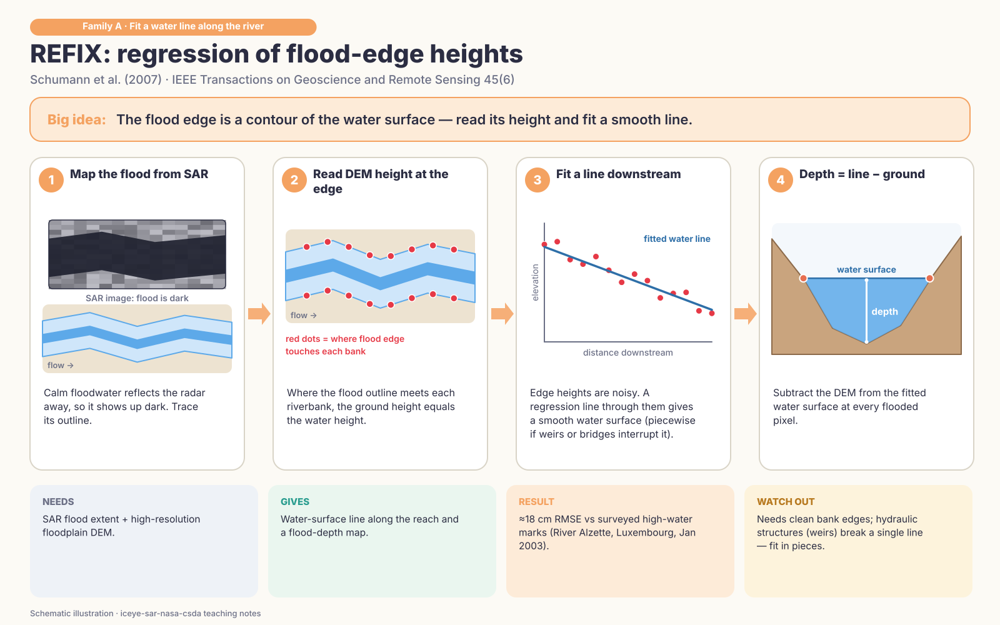

### Cross-section fitting — Zwenzner & Voigt 2009

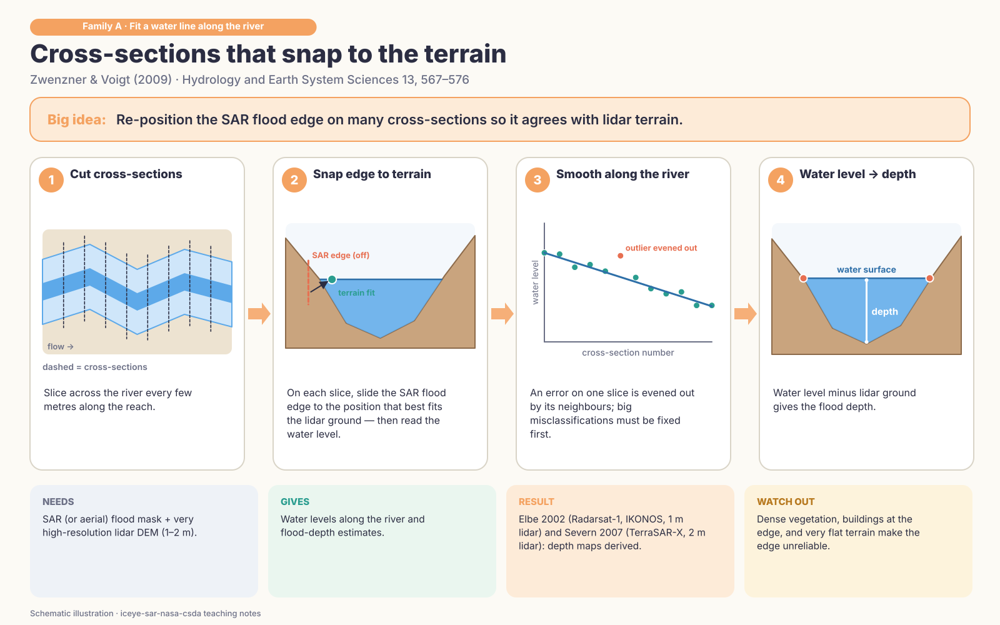

### Change detection + boundary statistics — Cian et al. 2018

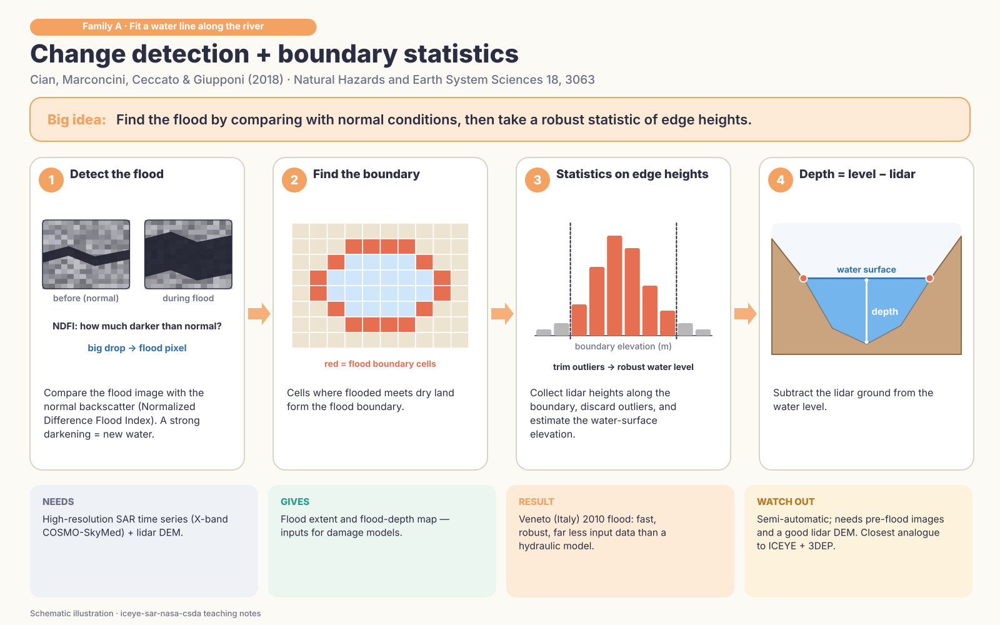

## Family B — spread flood-edge elevation inward

### FwDET v1 — Cohen et al. 2018

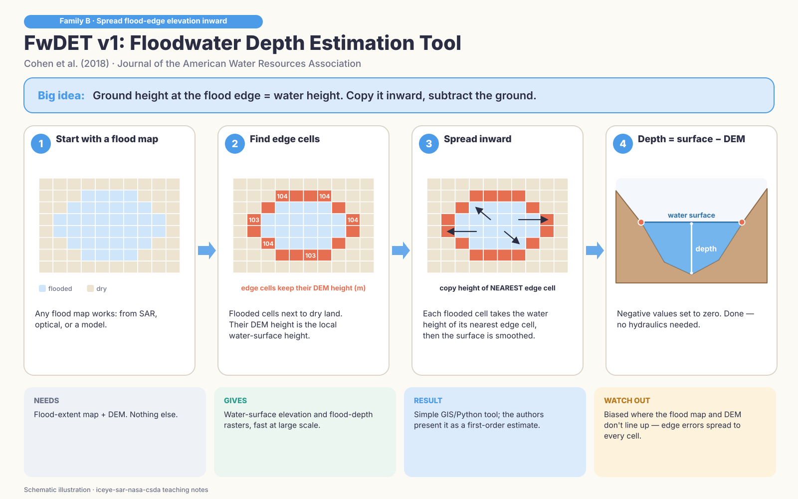

### FwDET v2.0 (coastal) — Cohen et al. 2019

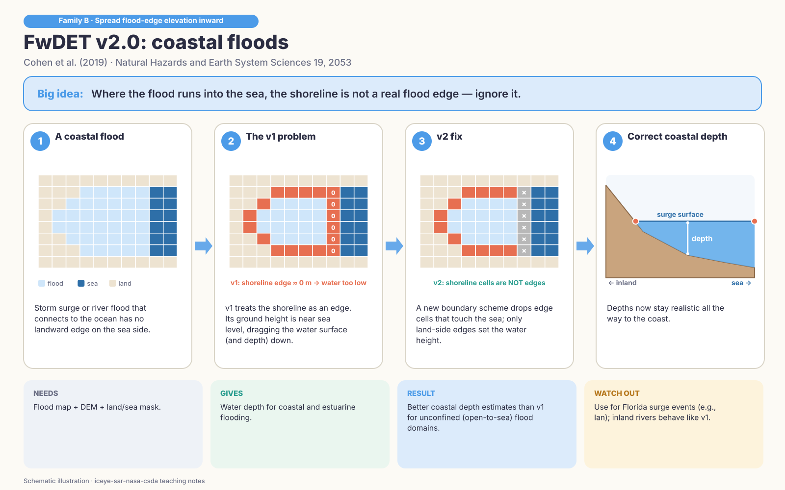

### FwDET v2.1 (edge cleaning) — Cohen et al. 2022

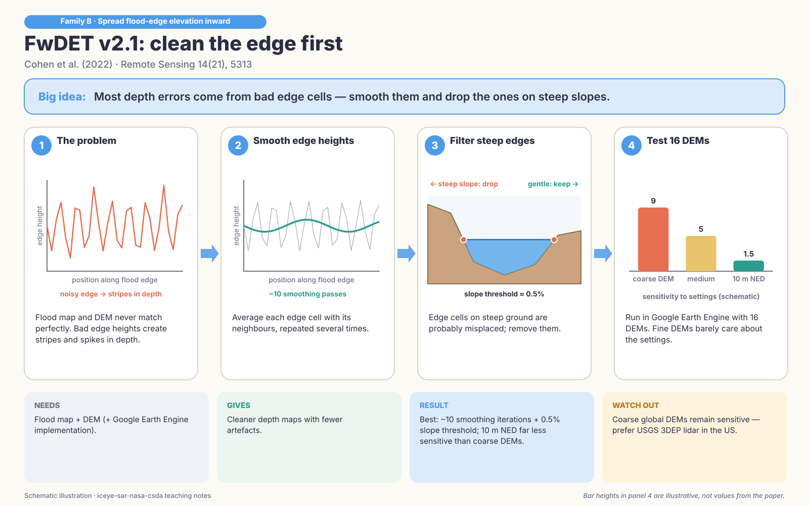

### FLEXTH — Betterle & Salamon 2024

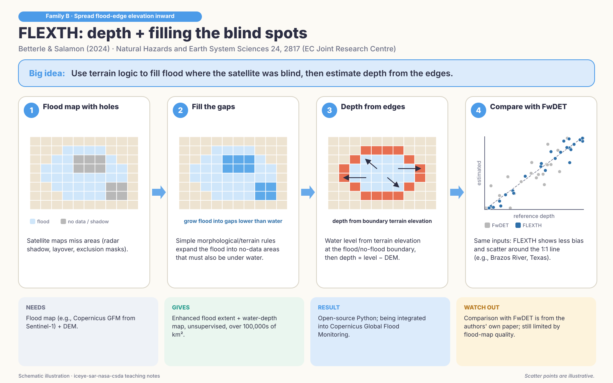

## Family C — height above nearest drainage (HAND)

### HAND / GeoFlood — Nobre 2011; Zheng et al. 2018

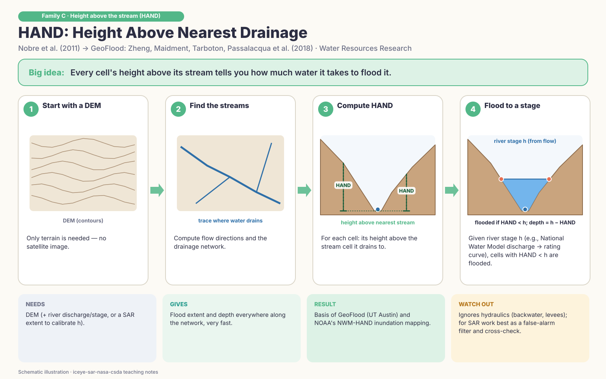

### NWM-HAND evaluation — Johnson et al. 2019

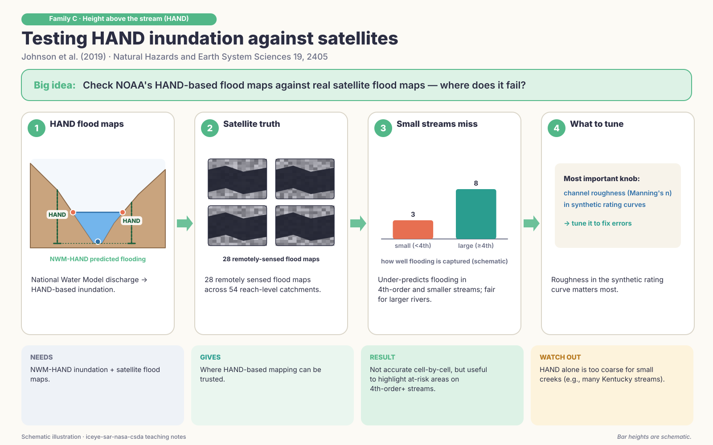

### RICorDE — Bryant et al. 2022

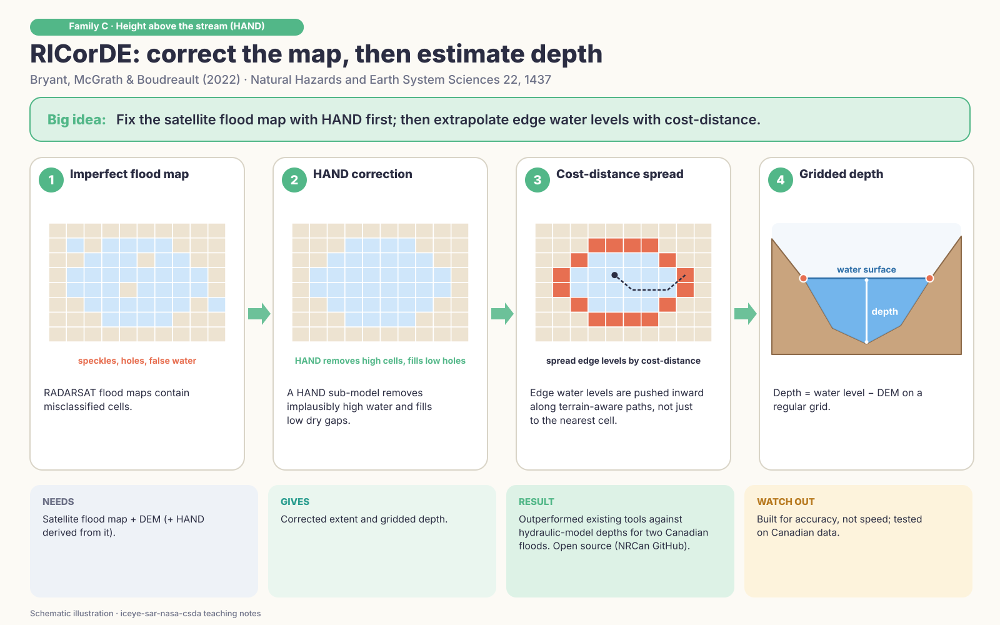

## Family D — comparisons & machine learning

### HAND vs TVD vs FwDET — Teng et al. 2022

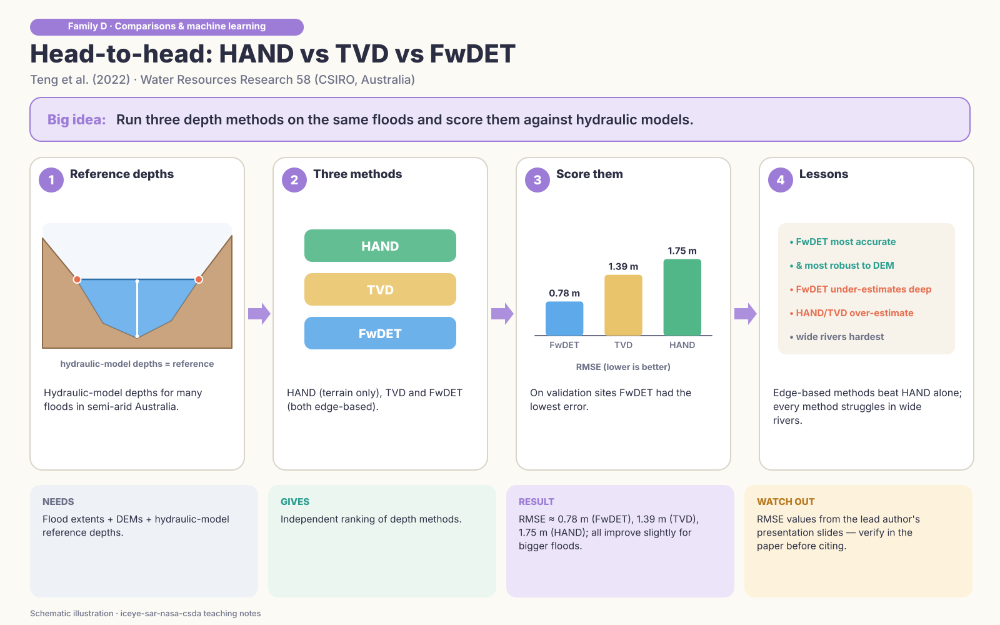

### End-to-end SAR benchmark — Travert et al. 2025/26

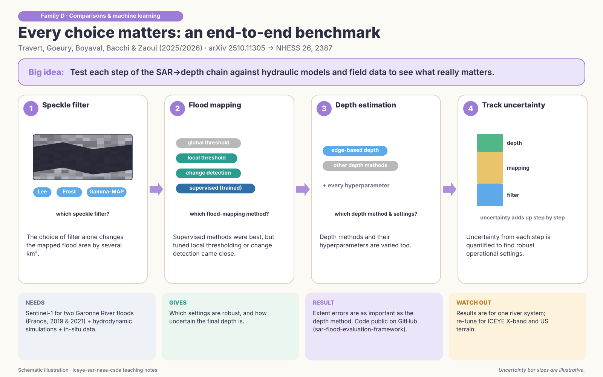

### Machine-learning depth — Elkhrachy 2022

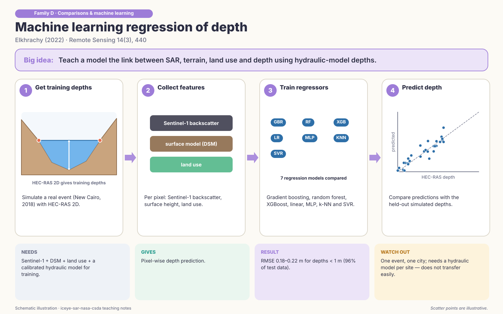

## Operational product (NASA)

### HydroSAR (NASA SERVIR) — Meyer et al. 2024

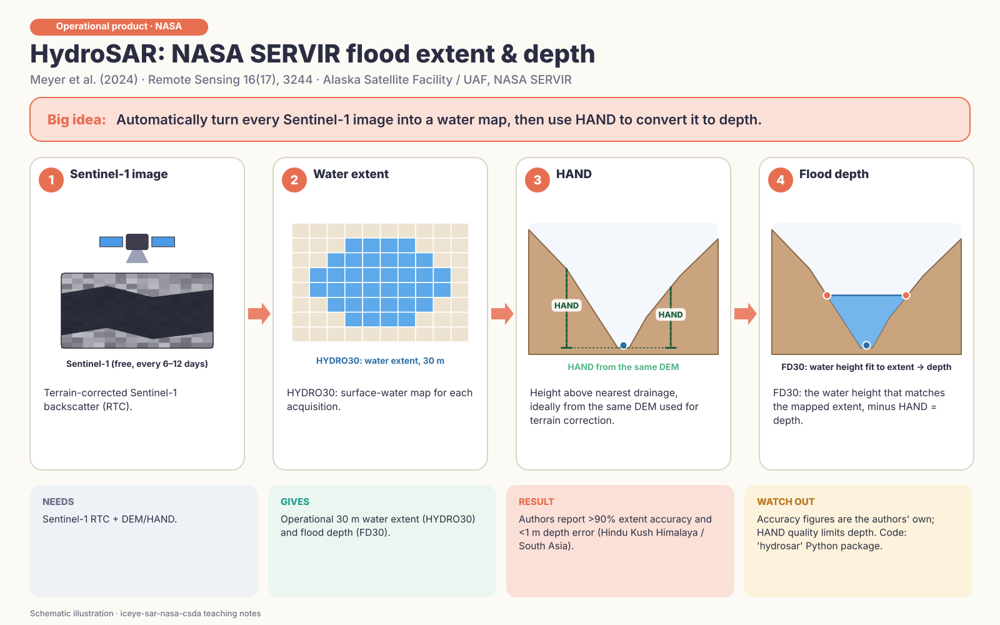

## Which to use with ICEYE + USGS 3DEP?

Flood extent by change detection / local thresholding with slope, HAND and permanent-water masks → depth with **FLEXTH** and **FwDET v2.1** (v2.0 coast rule for Florida) → **HAND/RICorDE** cross-check → validate with USGS high-water marks and gauges.
